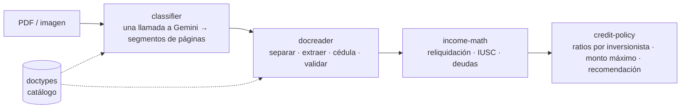

# edictus-document-ai

[English](README.md) · **Español**

IA que lee documentos financieros chilenos y los convierte en cálculo de
crédito.

Una solicitud de crédito hipotecario o de consumo llega como un montón de PDF y
fotos tomadas con el celular:
- cédulas;
- liquidaciones de sueldo;
- carpetas tributarias;
- informes de deuda CMF;
- cartolas bancarias;
- escrituras.

Este monorepo los clasifica y los separa, lee sus campos con Gemini y contrasta
la IA con parsers deterministas. Con el resultado alimenta una matemática pura
de ingresos y de políticas de crédito.

Se extrajo de una aplicación de análisis de crédito en producción y se separó en
paquetes que no dependen de esa aplicación.



## Paquetes

| Paquete | Qué hace |
|---|---|
| [`doctypes`](packages/doctypes) | Catálogo de tipos de documento chilenos: cómo se reconoce cada uno, qué campos entrega y cómo se comporta en el flujo. La fuente de verdad es un YAML que se compila a JSON, y el CI falla si se desalinean. |
| [`classifier`](packages/classifier) | Clasificador basado en el prompt: una sola llamada a Gemini ve el archivo completo y devuelve segmentos de páginas. El código local, de unas 200 líneas, solo limpia la geometría. Usa un perfil de generación determinista y una huella del prompt para las claves de caché. |
| [`docreader`](packages/docreader) | Motor de lectura detrás de una sola función, `readDocument()`: clasificar → separar → extraer campos → cédula compuesta → consolidar. En liquidaciones, informes CMF, créditos de consumo y boletas de honorarios, parsers deterministas mandan sobre la IA en los campos que dominan. |
| [`income-math`](packages/income-math) | Reliquidación de sueldos e impuesto único (IUSC) con las tablas tributarias incluidas, mezcla de los ajustes del analista con los datos frescos, y consolidación de activos y deudas. Funciones puras. |
| [`credit-policy`](packages/credit-policy) | Revisión de ratios por inversionista (dividendo/renta, carga financiera, deuda/precio, edad + plazo), monto máximo financiable y una recomendación de «qué decirle al cliente». Funciones puras. |

Paquetes hermanos que se usan aquí y se publican por separado:
[`extract`](https://github.com/luvidal/edictus-extract),
[`cedula`](https://github.com/luvidal/edictus-cedula),
[`tables`](https://github.com/luvidal/edictus-tables),
[`reports`](https://github.com/luvidal/edictus-reports).

## Decisiones de diseño

- **La aplicación anfitriona inyecta todo lo externo.** No hay SDK de IA en
  tiempo de ejecución: la aplicación entrega una función `geminiCall`, un
  almacén de caché y un logger. Los paquetes nunca leen claves, no tocan una
  base de datos ni conocen el framework web.
- **La IA propone, los parsers deciden.** Cuando un campo tiene un formato
  impreso estable (líneas de la liquidación, filas de deuda CMF, totales de
  boletas), un parser determinista es la autoridad y el modelo completa lo que
  falta. Hay un test de regresión para cada caso en que el modelo se equivocó.
- **Medido, no supuesto.** Los cambios de modelo y de prompt pasan por un arnés
  de *ground truth* contra un corpus local de documentos reales. Ese corpus
  nunca se sube al repo; todos los datos de prueba aquí son sintéticos.
- **Matemática pura en la base.** El código de ingresos y de políticas de
  crédito recibe objetos simples y devuelve datos simples, así que se prueba
  sin mocks.

## Cómo correrlo

```bash
npm install
npm run build
npm test        # ~315 tests entre los cinco paquetes
```

El playground del clasificador y el arnés del corpus necesitan una
`GEMINI_API_KEY` (o credenciales de Vertex): ver
[`packages/classifier`](packages/classifier).

## Estado

Anterior a la 1.0. Publicado como muestra de portafolio, con un historial
nuevo.
