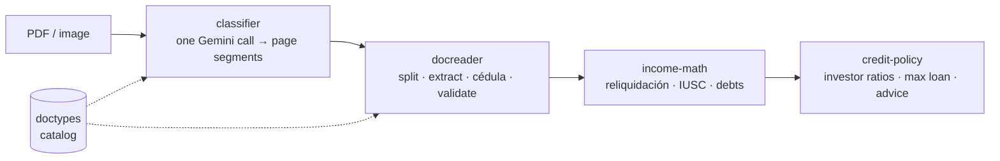

# edictus-document-ai

**English** · [Español](README.es.md)

AI that reads Chilean financial documents and turns them into credit math.

A mortgage or consumer-loan file arrives as a pile of PDFs and phone photos:
ID cards, payslips, tax folders, CMF debt reports, bank statements, property
deeds. This monorepo classifies and splits them, reads their fields with
Gemini, cross-checks the AI against deterministic parsers, and feeds the
result into pure income and credit-policy math.

Extracted from a production credit-analysis app into host-agnostic packages.



## Packages

| Package | What it does |
|---|---|
| [`doctypes`](packages/doctypes) | Catalog of Chilean document types (YAML source of truth → compiled JSON, with a CI drift gate): how each is recognized, which fields it yields, how it behaves in the pipeline. |
| [`classifier`](packages/classifier) | Prompt-first classifier: one Gemini call sees the whole file and returns page segments; ~200 lines of local geometry cleanup. Deterministic generation profile and a prompt fingerprint for cache keys. |
| [`docreader`](packages/docreader) | The read engine behind a single `readDocument()` facade: classify → split → field-extract → composite cédula → collapse. Deterministic parsers for payslips, CMF reports, consumer loans and fee receipts override the AI on the fields they own. |
| [`income-math`](packages/income-math) | Payslip reliquidación and IUSC tax with bundled tax tables, analyst-edit hydration, and asset/debt merges. Pure functions. |
| [`credit-policy`](packages/credit-policy) | Per-investor ratio checks (dividend/income, debt load, LTV, age + term), maximum financeable amount, and a "what to tell the client" recommendation. Pure functions. |

Sibling packages used here and published on their own:
[`extract`](https://github.com/luvidal/edictus-extract),
[`cedula`](https://github.com/luvidal/edictus-cedula),
[`tables`](https://github.com/luvidal/edictus-tables),
[`reports`](https://github.com/luvidal/edictus-reports).

## Design choices

- **Host-injected ports.** No AI SDK at runtime: the host passes a `geminiCall`
  function, a cache store and a logger. The packages never read keys, touch a
  database or know about the web framework.
- **AI proposes, parsers decide.** Where a field has a stable printed layout
  (payslip lines, CMF debt rows, fee-receipt totals), a deterministic parser is
  authoritative and the model fills the gaps — regression tests pin each case
  where the model was wrong.
- **Measured, not guessed.** Model and prompt changes go through a ground-truth
  harness against a local corpus of real documents. The
  corpus is never committed; every fixture in this repo is synthetic.
- **Pure math at the bottom.** Income and credit-policy code takes plain
  objects and returns plain data, so it is tested without mocks.

## Run it

```bash
npm install
npm run build
npm test        # ~315 tests across the five packages
```

The classifier playground and corpus harness need a `GEMINI_API_KEY`
(or Vertex credentials) — see [`packages/classifier`](packages/classifier).

## Status

Pre-1.0. Published as a portfolio snapshot with a fresh history.
